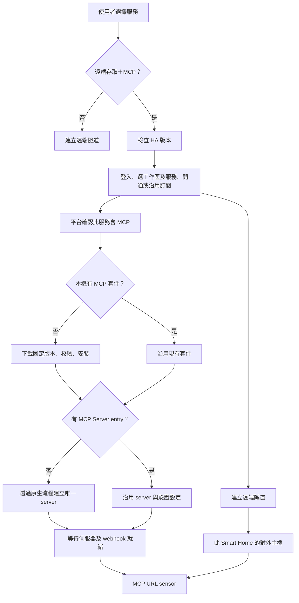

# Smart Home MCP 自動設定與 URL sensor

2026-10-19；0.4.14 候選版。這份文件描述已實作並驗證的行為，尚不代表 GitHub main 或真機已更新。

## 研究確認

### 套件與服務的關係

使用的 woowtech repository 是 [WOOWTECH/Woow_ha_ai_mcp](https://github.com/WOOWTECH/Woow_ha_ai_mcp/tree/c7b8d79fea7228007d7af9291f3a03afc4d3e071)，
HA domain 為 `ha_mcp_tools`，component 版本 1.2.2。
原生設定流程有兩種 entry：`tools` 提供進階 HA 檔案功能；`server` 才會啟動 MCP 伺服器。
只有 tools entry 不能視為 MCP server 已經運作。
原生 server 要求 HA 2026.6.0 以上，見 [config_flow.py](https://github.com/WOOWTECH/Woow_ha_ai_mcp/blob/c7b8d79fea7228007d7af9291f3a03afc4d3e071/custom_components/ha_mcp_tools/config_flow.py)。

MCP server 會在背景安裝 Python 依賴、建立必要的 HA 存取身分、啟動伺服器，最後註冊 webhook。
其 config entry 會先進入 LOADED，因此 LOADED 本身不足以判定可連線。
見 [embedded_entry.py](https://github.com/WOOWTECH/Woow_ha_ai_mcp/blob/c7b8d79fea7228007d7af9291f3a03afc4d3e071/custom_components/ha_mcp_tools/embedded_entry.py)
及 [embedded_setup.py](https://github.com/WOOWTECH/Woow_ha_ai_mcp/blob/c7b8d79fea7228007d7af9291f3a03afc4d3e071/custom_components/ha_mcp_tools/embedded_setup.py)。

### 舊版缺口

- Smart Home Connect 0.4.13 只有本機 MCP 偵測，沒有下載或建立 server 的流程。
- 偵測使用「任何已載入的 MCP entry」，可能將 tools entry 或尚在啟動的 server 判為 running。
- webhook id 存在時就組網址，未確認實際 webhook 是否已註冊。
- 舊有 URL sensor 的 unique_id 仍在，但 state 已改成 `available`／`unavailable`，所以裝置頁看不到可複製網址。

## 新流程



| 情境 | 候選版行為 |
|---|---|
| 只選遠端存取、Security Access、未含 MCP 的訂閱 | 不下載 MCP |
| 尚未安裝 MCP | 下載 woowtech 固定 commit，校驗 SHA-256，再安裝 component |
| 已安裝但沒有 server，或只有 tools entry | 自動建立 HA-MCP Server |
| 已有正常 server | 直接沿用，不改密鑰或 OAuth，不重建第二份 |
| 多個 Smart Home 同時啟動 | 共用安裝鎖與原生唯一識別碼，避免重複安裝及建立 |
| 使用者手動停用 server 或關閉 webhook | 保留選擇，顯示中文修復提示 |
| 下載、網路或背景啟動失敗 | 每五分鐘重試；保留遠端隧道的獨立運作 |
| 重啟 HA | 沿用已安裝套件、同一 server entry 與密鑰 |
| 退訂 MCP | 移除本整合的 MCP sensors；不刪除可能被其他用途使用的本機 server |

首次安裝採用 [HACS 的 custom component 快取刷新方式](https://github.com/hacs/integration/blob/main/custom_components/hacs/repositories/integration.py)，
在本次 HA 2026.7.2 冷安裝中，下載後直接完成原生 server 設定，沒有為了載入新套件而重啟 HA。
自動安裝不需要使用者提供 GitHub token，也不依賴已安裝 HACS。
若設定目錄不可寫或已有損壞的 component，會提供修復提示，不覆寫既有檔案。

## URL sensor

診斷區名稱恢復為 **MCP URL**；state 為：

```text
https://<此 Smart Home 的隧道主機>/api/webhook/<MCP 隨機密鑰>
```

保留 `{entry_id}_mcp_connect_url` unique_id，因此既有 entity_id 與裝置關係不變。
entity_id 可能仍包含 `mcp_connection_availability`，但顯示名稱與內容會更新。
沒有可用端點時顯示 unknown；不在 attributes 重複放置密鑰。
點開實體詳細視窗可選取完整網址。

只有 server 已完成啟動、實際運作、webhook 已註冊且允許遠端 POST 時，才發布網址。
偵測異常時清除本輪 URL，避免沿用可能已旋轉或失效的舊密鑰。

HTTPS 加密的是傳輸，URL 路徑本身是存取密鑰，並非「將 URL 字串加密」。
原有 HA OAuth 設定仍然生效；擁有網址不會略過 OAuth。
見 [MCP webhook 實作](https://github.com/WOOWTECH/Woow_ha_ai_mcp/blob/c7b8d79fea7228007d7af9291f3a03afc4d3e071/custom_components/ha_mcp_tools/mcp_webhook.py)。

依本次需求，完整密鑰網址會出現在 HA state，能被具有狀態讀取權限的使用者、模板及 recorder 讀取。
若需排除歷史記錄，使用 [recorder.exclude.entities](https://www.home-assistant.io/integrations/recorder/#configure-filter)
指定實際 entity_id。本更新不會改全站 recorder 設定或清除舊歷史。

## 驗證範圍與限制

- **乾淨 HA 2026.7.2：**初始無 component、無 server entry；完成下載、校驗、安裝及原生啟用。安裝後 32 個檔案與指定 woowtech commit 逐一比對，差異為零。
- **實際 MCP：**initialize HTTP 200、tools/list HTTP 200（77 項）、唯讀 overview 成功；錯誤密鑰無法取得 MCP 結果。
- **實際 HA state：**候選 sensor 在 HA sensor platform 中發布完整 URL。
- **重新啟動：**server entry、密鑰與 URL 保持一致，未產生第二份 server。
- **既有真機外網：**原有 HTTPS 隧道上的 initialize、77 項工具及唯讀 overview 再次通過；此項測的是既有正式套件。
- **完整 HA 套件回歸：184 項通過。**在既有 HA 2026.2.3 fixture 環境執行；MCP 版本檢查另有測試。這不代表 2026.2.3 可運行嵌入式 MCP。
- **MCP 專項：31 項通過。**在 HA 2026.7.2／Python 3.14 執行，命令為 `python3 scripts/test_mcp.py`。

安裝來源固定的是 component 1.2.2。MCP server 採原生穩定版依賴解析與更新機制，本次實際安裝的是 `ha-mcp` 8.7.0。
因此沒有宣稱整個依賴樹都已鎖定版本。

本次未更新使用者真機、未變更正式 PaaS、未將候選版推送或合併 GitHub main。
「新安裝後經新訂閱的 HTTPS 隧道連線」以及手機裝置頁的最終顯示，仍須在正式更新後驗收；
目前證據分別涵蓋冷安裝後的本機 MCP 協定及既有真機的外網通路。
