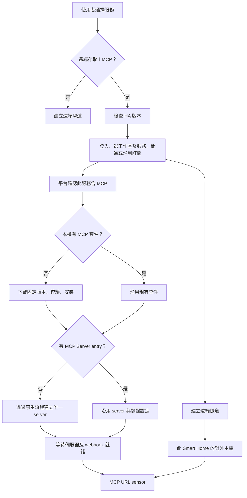

# Smart Home MCP 自動設定與 URL sensor

2026-10-19～20；0.4.15。這份文件記錄套件行為、發布前驗證與實機部署驗收。

## 研究確認

### 套件與服務的關係

使用的 woowtech repository 是 [WOOWTECH/Woow_ha_ai_mcp](https://github.com/WOOWTECH/Woow_ha_ai_mcp/tree/da0d2f3e7dcd85927921599ed49c0b8c61aea456)，
HA domain 為 `ha_mcp_tools`，component 版本 1.2.3。
原生設定流程有兩種 entry：`tools` 提供進階 HA 檔案功能；`server` 才會啟動 MCP 伺服器。
只有 tools entry 不能視為 MCP server 已經運作。
原生 server 要求 HA 2026.6.0 以上，見 [config_flow.py](https://github.com/WOOWTECH/Woow_ha_ai_mcp/blob/da0d2f3e7dcd85927921599ed49c0b8c61aea456/custom_components/ha_mcp_tools/config_flow.py)。

MCP server 會在背景安裝 Python 依賴、建立必要的 HA 存取身分、啟動伺服器，最後註冊 webhook。
其 config entry 會先進入 LOADED，因此 LOADED 本身不足以判定可連線。
見 [embedded_entry.py](https://github.com/WOOWTECH/Woow_ha_ai_mcp/blob/da0d2f3e7dcd85927921599ed49c0b8c61aea456/custom_components/ha_mcp_tools/embedded_entry.py)
及 [embedded_setup.py](https://github.com/WOOWTECH/Woow_ha_ai_mcp/blob/da0d2f3e7dcd85927921599ed49c0b8c61aea456/custom_components/ha_mcp_tools/embedded_setup.py)。

### 舊版缺口

- Smart Home Connect 0.4.13 只有本機 MCP 偵測，沒有下載或建立 server 的流程。
- 偵測使用「任何已載入的 MCP entry」，可能將 tools entry 或尚在啟動的 server 判為 running。
- webhook id 存在時就組網址，未確認實際 webhook 是否已註冊。
- 舊有 URL sensor 的 unique_id 仍在，但 state 已改成 `available`／`unavailable`，所以裝置頁看不到可複製網址。

## 新流程



| 情境 | 0.4.14 行為 |
|---|---|
| 只選遠端存取、Security Access、未含 MCP 的訂閱 | 不下載 MCP |
| 尚未安裝 MCP | 下載 woowtech 固定 commit，校驗 SHA-256，再安裝 component |
| 已安裝但沒有 server，或只有 tools entry | 自動建立 HA-MCP Server |
| 已有正常 server | 直接沿用，不改密鑰或 OAuth，不重建第二份 |
| 多個 Smart Home 同時啟動 | 共用安裝鎖與原生唯一識別碼，避免重複安裝及建立 |
| 使用者手動停用 server 或關閉 webhook | 保留選擇，顯示中文修復提示 |
| 下載、網路或背景啟動失敗 | 每五分鐘重試；保留遠端隧道的獨立運作 |
| 重啟 HA | 沿用已安裝套件、同一 server entry 與密鑰 |
| 退訂 MCP | 移除本整合的 MCP sensors；不刪除可能被其他用途使用的本機 server |

首次安裝採用 [HACS 的 custom component 快取刷新方式](https://github.com/hacs/integration/blob/main/custom_components/hacs/repositories/integration.py)，
在本次 HA 2026.7.2 冷安裝中，下載後直接完成原生 server 設定，沒有為了載入新套件而重啟 HA。
自動安裝不需要使用者提供 GitHub token，也不依賴已安裝 HACS。
若設定目錄不可寫或已有損壞的 component，會提供修復提示，不覆寫既有檔案。

## URL sensor

診斷區名稱恢復為 **MCP URL**；state 為：

```text
https://<此 Smart Home 的隧道主機>/api/webhook/<MCP 隨機密鑰>
```

保留 `{entry_id}_mcp_connect_url` unique_id，因此既有 entity_id 與裝置關係不變。
entity_id 可能仍包含 `mcp_connection_availability`，但顯示名稱與內容會更新。
沒有可用端點時顯示 unknown；不在 attributes 重複放置密鑰。
點開實體詳細視窗可選取完整網址。

只有 server 已完成啟動、實際運作、webhook 已註冊且允許遠端 POST 時，才發布網址。
偵測異常時清除本輪 URL，避免沿用可能已旋轉或失效的舊密鑰。

HTTPS 加密的是傳輸，URL 路徑本身是存取密鑰，並非「將 URL 字串加密」。
原有 HA OAuth 設定仍然生效；擁有網址不會略過 OAuth。
見 [MCP webhook 實作](https://github.com/WOOWTECH/Woow_ha_ai_mcp/blob/da0d2f3e7dcd85927921599ed49c0b8c61aea456/custom_components/ha_mcp_tools/mcp_webhook.py)。

依本次需求，完整密鑰網址會出現在 HA state，能被具有狀態讀取權限的使用者、模板及 recorder 讀取。
若需排除歷史記錄，使用 [recorder.exclude.entities](https://www.home-assistant.io/integrations/recorder/#configure-filter)
指定實際 entity_id。本更新不會改全站 recorder 設定或清除舊歷史。

## 驗證範圍與限制

- **乾淨 HA 2026.7.2：**初始無 component、無 server entry；完成下載、校驗、安裝及原生啟用。安裝後 32 個檔案與指定 woowtech commit 逐一比對，差異為零。
- **實際 MCP：**initialize HTTP 200、tools/list HTTP 200（77 項）、唯讀 overview 成功；錯誤密鑰無法取得 MCP 結果。
- **實際 HA state：**候選 sensor 在 HA sensor platform 中發布完整 URL。
- **重新啟動：**server entry、密鑰與 URL 保持一致，未產生第二份 server。
- **既有真機外網：**原有 HTTPS 隧道上的 initialize、77 項工具及唯讀 overview 再次通過；此項測的是既有正式套件。
- **完整 HA 套件回歸：184 項通過。**在既有 HA 2026.2.3 fixture 環境執行；MCP 版本檢查另有測試。這不代表 2026.2.3 可運行嵌入式 MCP。
- **MCP 專項：31 項通過。**在 HA 2026.7.2／Python 3.14 執行，命令為 `python3 scripts/test_mcp.py`。

安裝來源固定的是 component 1.2.3。MCP server 採原生穩定版依賴解析與更新機制，本次實際安裝的是 `ha-mcp` 8.7.0。
因此沒有宣稱整個依賴樹都已鎖定版本。

上述為發布前驗證基線；正式 PaaS 不需要配合這次 HA 套件更新修改。

## 0.4.15 相容性修正

實際 HAOS VM（HA 2026.10.1）首次安裝發現 `voluptuous_openapi` 缺少，MCP entry 因此無法啟動。woowtech MCP component 1.2.3 已在 manifest 宣告 `voluptuous-openapi>=0.3.0`，Connect 0.4.15 固定下載該修正 commit 並更新 SHA-256。

MCP 相依宣告與相關啟動邏輯的 512 項單元測試通過。最低相依版本保留 HA 2026.6 的 `voluptuous-openapi==0.3.0` 相容性；該版本已提供所需的 `convert_to_voluptuous`。HA 2026.10.1 實測自動安裝到 0.4.1。

VM 已完成正式 PaaS 新帳號登入、OAuth、工作區／服務自動建立與七天試用。試用到期日為 2026-10-25，沒有下一次自動扣款日期。

### 0.4.15 實機結果

| 驗收 | 實體 HA 2026.7.2 | PaaS HAOS VM 2026.10.1 |
|---|---|---|
| Connect／MCP component | 0.4.15／1.2.3 | 0.4.15／1.2.3 |
| MCP 安裝方式 | 更新既有套件並沿用 Server | 原始無 MCP；由 Connect 自動下載並建立 Server |
| HTTPS 網頁及登入後 API | 通過 | 通過，HAOS 使用 port 80 |
| MCP initialize／tools/list | HTTP 200／77 項工具 | HTTP 200／77 項工具 |
| 唯讀 ha_get_overview | 實際 HA 查詢成功 | 實際 HA 查詢成功 |
| 錯誤密鑰 | 無法取得 MCP 結果 | 無法取得 MCP 結果 |
| MCP URL sensor | 保留既有 entity_id，顯示完整網址 | 新增完整網址 sensor |
| 390 × 844 手機檢查 | 裝置頁及實體詳細視窗通過 | 外網裝置頁及實體詳細視窗通過 |
| HA 重啟 | 沿用 Server 與密鑰 | 沿用 Server 與密鑰，無重複建立 |

完整 Connect 回歸 184 項、MCP 專項 31 項、MCP 相關單元測試 512 項通過。另以 HA 2026.6.4 與正式 `ha-mcp==8.7.0` 完成 4 項嵌入式端到端測試（含 LLM API 完整工具清單轉換）。此測試透過驗收 fixture 指定正式 Server；fork 原有測試預設會建立 7.7.0 wheel，低於 component 的 7.10.0 下限，因此沒有宣稱該 fork 自建 Server wheel 的測試通過。

兩台主機各 191 個安裝檔案與 Connect `3d72dfc3fca054849bd97485e07f1e8f7d1b8a3c`／MCP `da0d2f3e7dcd85927921599ed49c0b8c61aea456` 比對，差異為零。Connect 的 GitHub 與 Gitea `main` 均已同步。

實體 HA 最後一次完整重啟（台灣時間 2026-10-20 00:22～00:23），外網網頁中斷約 21 秒，Smart Home 隧道約 43 秒；這是 HA 重啟時間，不是 Odoo chart 升級的停機驗收。

### 新版 HA HTTP 設定

VM 首次外網請求回傳 400，原因是沒有設定可信任的本機反向代理。HA 2026.8 起 HTTP 設定改由介面管理，已有設定時新增 YAML 不會覆蓋它。實測使用官方 `http/config/configure` API，僅信任 `127.0.0.1/32` 與 `::1/128`；重啟後確認外網網頁、驗證過的 WebSocket 可用，再透過 `http/config/promote` 儲存。已移除測試時新增的舊式 YAML 設定，原有設定檔其餘內容保持一致。

此 HTTP 設定是 HA 安裝前置條件，Connect 不會自動改寫管理者的 HTTP 安全設定。操作方式見 [README](../README.md#home-assistant-反向代理設定) 與 [HA 官方文件](https://www.home-assistant.io/integrations/http/)。

新的 24 小時觀測涵蓋 PaaS、實體 HA 與 VM 的外網 MCP；功能驗收通過不等於 24 小時觀測已完成。觀測不呼叫付費 LLM。

## 0.4.14 正式部署驗收（2026-10-19）

- GitHub `main` 已發布 0.4.14 的實作，程式提交為 `51f5e008a0e3262130bf67989abed0ce71a4f5a4`。
- 實體 HA 2026.7.2 已由 0.4.12 更新到 0.4.14，重新啟動後 Smart Home 與原生 MCP entry 均載入成功。
- 沿用同一個原生 MCP Server entry，沒有新增第二份；遠端隧道已恢復連線。
- 既有 entity_id 保留，名稱更新為 **MCP URL**，state 已恢復完整 HTTPS webhook 網址。
- 從對外 HTTPS 網址實際完成 initialize、tools/list（77 項）、唯讀 `ha_get_overview`；錯誤密鑰無法取得 MCP 結果。
- 390 × 844 手機尺寸的 HA 裝置頁與實體詳細視窗已檢查。HA 可能在長網址中插入排版用的零寬字元；API state 保留原始網址。驗收截圖遮蔽密鑰。
- PaaS 專用 HAOS VM（HA 2026.10.1）已安裝相同版本並重啟，159 個來源檔案核對一致、12 個執行期 Python 檔案編譯及套件匯入成功；當時沒有既有 MCP 套件。
- 當時 VM 的首次登入驗收尚未完成；後續取得測試登入資料並完成 OAuth 與試用建立，冷安裝發現的相容性問題見上方 0.4.15 段落。
- 更新後已另開 24 小時觀測，涵蓋 PaaS、實體 HA 對外網頁、MCP URL sensor 與外網 MCP 工具清單；觀測完成前不標記為 24 小時通過。

手動部署時，暫存套件與回復用備份必須放在 `custom_components` 目錄以外；HA 也可能掃描其中的隱藏目錄，重複的 manifest 會干擾載入。
